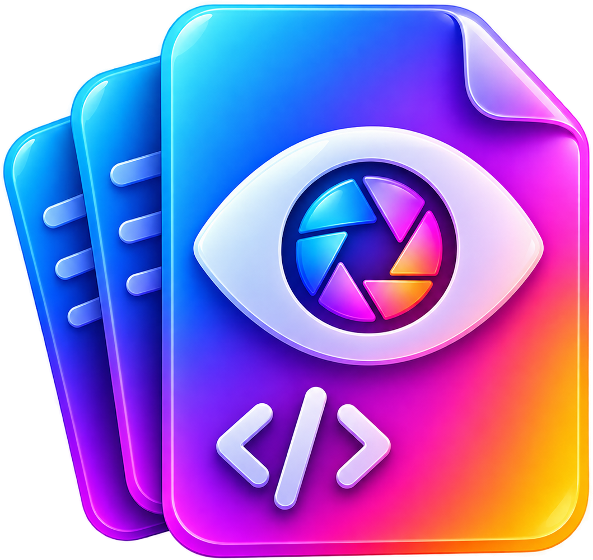

<div align="center">



# Batch Viewer

**The lightning-fast, all-in-one document viewer & editor for Windows 11.**  
*Effortlessly read, edit, annotate, and export Markdown, PDF, Word, and text files in a unified, distraction-free workspace.*

[](https://github.com/ismailjosim/batch-viewer-project)
[](https://github.com/ismailjosim/batch-viewer-project)
[](https://www.electronjs.org/)
[](https://react.dev/)
[](LICENSE)

</div>

---

## 🌟 Overview

**Batch Viewer** is a modern desktop application built for developers, writers, researchers, and students. Instead of juggling separate software for reading PDFs, drafting Markdown, reviewing Word documents, or checking logs, Batch Viewer provides a single high-performance workspace with a tabbed interface, dark/light themes, and native Windows integration.

---

## ✨ Key Features

### 📑 1. Multi-Document Tab System
- **Universal Tab Bar**: Open dozens of files across formats in organized tabs.
- **Context Menus**: Right-click tabs to close current, close others, close tabs to the right, copy file path, or reveal in File Explorer.
- **Dirty State Tracking**: Instant visual dot indicator (`•`) on tabs with unsaved modifications and close-confirmation protection.
- **Drag & Drop**: Drop files or folders directly anywhere into the window to open them immediately.

---

### 📕 2. PDF Annotator, Highlighter & Comments
- **High-Resolution Canvas**: Crisp page rendering with responsive zoom (`50%` to `300%`), fit-to-width, and continuous page scrolling.
- **Visual Highlighter**: Highlight text selections or drag rectangular bounding boxes with customizable colors (Yellow, Blue, Green, Pink, Violet).
- **Sticky Page Comments**: Click anywhere on a page to attach a comment pin.
- **Interactive Notes Drawer**: Slide-over panel summarizing all highlights and comments with jump-to-page navigation and deletion.
- **Permanent Binary Saving (`Ctrl + S`)**: Uses `pdf-lib` to burn highlights and comments permanently into the `.pdf` file so other PDF viewers (Adobe Acrobat, Edge, Chrome) see your annotations.

---

### 📝 3. Markdown Reader & Split-View Editor
- **Three Viewing Modes**: Toggle between pure Reader View, full Editor View, or synchronized Split View (`Ctrl + E`).
- **Synchronized Scrolling**: Dual-pane editor and preview stay strictly synchronized as you scroll.
- **Formatting Toolbar**: One-click insertions for Headings (H1–H3), Bold, Italic, Strikethrough, Task Lists (`- [ ]`), Blockquotes, Code blocks, Tables, Links, and Images.
- **Rich GFM & Extensions**:
  - 📐 **LaTeX Math**: Render formulas and equations via KaTeX (`$E=mc^2$` and `$$\sum_{i=1}^n i$$`).
  - 📊 **Mermaid Diagrams**: Interactive flowcharts, sequence diagrams, state machines, and Gantt charts.
  - 💻 **Syntax Highlighting**: Over 50+ programming languages powered by `highlight.js`.
- **Standalone HTML Export**: Export styled documents as a self-contained `.html` file with embedded styling and KaTeX fonts.

---

### 📘 4. Word (.docx) & Google Docs Viewer
- **Authentic Paper Layout**: Converts `.docx` documents into clean, styled paper sheets powered by Mammoth.
- **Reading / Editing Modes**: Switch between formatted document view and inline content editing.
- **Save as PDF**: Export Word documents directly to PDF with one click.

---

### 💻 5. Plain Text & Code Editor
- **Fast Text Editing**: Lightweight editor for `.txt`, `.log`, `.json`, `.csv`, `.yml`, `.xml`, `.js`, `.ts`, `.py`, `.html`, `.css`.
- **Developer Essentials**: Line numbering, monospace typography, search and replace (`Ctrl + F`), and auto-indent.

---

### 📁 6. Workspace Explorer & Document Outline
- **Sidebar File Tree**: Open any project folder to browse, open, and manage documents with file size info and type badges.
- **Live Search Filter**: Filter large directory trees instantly by filename.
- **Headings Outline**: Auto-generated Table of Contents (TOC) mapping H1 to H6 headings for one-click jump navigation.

---

### 🏠 7. Modern Overview Screen
- **Welcome Dashboard**: Clean landing screen when no files are open.
- **Quick Launch Cards**: Open File, Open Directory Workspace, or Create New Document.
- **Recent Files List**: Chronological grid of recently opened documents with badges, relative timestamps, and one-click removal.

---

## ⌨️ Keyboard Shortcuts

| Shortcut | Action |
| :--- | :--- |
| <kbd>Ctrl</kbd> + <kbd>O</kbd> | Open File(s) from disk |
| <kbd>Ctrl</kbd> + <kbd>Shift</kbd> + <kbd>O</kbd> | Open Workspace Folder |
| <kbd>Ctrl</kbd> + <kbd>S</kbd> | Save changes (Burns annotations into PDF) |
| <kbd>Ctrl</kbd> + <kbd>Shift</kbd> + <kbd>S</kbd> | Save As new file |
| <kbd>Ctrl</kbd> + <kbd>N</kbd> | Create new document tab |
| <kbd>Ctrl</kbd> + <kbd>W</kbd> | Close active tab |
| <kbd>Ctrl</kbd> + <kbd>Tab</kbd> | Switch to next tab |
| <kbd>Ctrl</kbd> + <kbd>Shift</kbd> + <kbd>Tab</kbd> | Switch to previous tab |
| <kbd>Ctrl</kbd> + <kbd>E</kbd> | Cycle Markdown mode (Reader ➔ Split ➔ Editor) |
| <kbd>Ctrl</kbd> + <kbd>B</kbd> | Toggle Sidebar (Files / Outline) |
| <kbd>Ctrl</kbd> + <kbd>F</kbd> | Find in document |
| <kbd>Ctrl</kbd> + <kbd>P</kbd> | Print / Export to PDF |
| <kbd>Ctrl</kbd> + <kbd>+</kbd> / <kbd>=</kbd> | Zoom In |
| <kbd>Ctrl</kbd> + <kbd>-</kbd> | Zoom Out |
| <kbd>Ctrl</kbd> + <kbd>0</kbd> | Reset Zoom to 100% |

---

## 🏗️ Architecture & Clean Code

The codebase is built following clean modular design principles with strict separation of concerns, keeping all components under 300 lines:

```
batch-viewer/
├── src/
│   ├── main/                    # "Server Component" — Electron Backend
│   │   ├── index.ts             # App lifecycle, single-instance lock & CLI args
│   │   ├── windowManager.ts     # Window state, chrome frame & window controls
│   │   └── fileManager.ts       # Filesystem service, directory scanner & native IO
│   ├── preload/
│   │   └── index.ts             # Secure contextBridge API definition
│   └── renderer/                # Client Application (React 18 + TypeScript)
│       ├── App.tsx              # Main orchestrator & layout
│       ├── components/
│       │   ├── overview/        # Welcome hero, action cards & recents grid
│       │   ├── pdf/             # PDF canvas item, toolbar, drawer & modal
│       │   ├── sidebar/         # Workspace tree & document headings outline
│       │   ├── common/          # Drag-and-drop overlay & toast notifications
│       │   ├── Editor.tsx       # Markdown Monaco-style editor
│       │   ├── MarkdownViewer.tsx# Rendered GFM preview with KaTeX & Mermaid
│       │   ├── WordViewer.tsx   # Docx paper sheet viewer
│       │   ├── TextEditor.tsx   # Monospace text editor
│       │   ├── TabBar.tsx       # Document tabs with context menu
│       │   ├── TitleBar.tsx     # Custom Windows 11 title bar
│       │   └── StatusBar.tsx    # Document stats, zoom & format info
│       ├── hooks/
│       │   ├── useDocumentTabs.ts     # Document tabs lifecycle & saving
│       │   ├── useRecentFiles.ts      # Persistent recent files management
│       │   └── useKeyboardShortcuts.ts# Global hotkeys handler
│       └── utils/
│           └── htmlExport.ts    # Standalone HTML bundle generator
```

---

## 🚀 Getting Started

### Prerequisites
- **Node.js**: v18.0.0 or higher
- **npm**: v9.0.0 or higher

### Installation

1. Clone the repository:
   ```bash
   git clone https://github.com/ismailjosim/batch-viewer-project.git
   cd batch-viewer-project
   ```

2. Install dependencies:
   ```bash
   npm install
   ```

3. Launch development server:
   ```bash
   npm run dev
   ```

---

## 📦 Building & Distribution

### 1. Build Local Unpacked Executable
Compile the TypeScript code and generate an unpacked standalone Windows executable:
```bash
npm run pack
```
The executable is located in:
```
release/win-unpacked/Batch-Viewer.exe
```

### 2. Build Windows Installer (.exe & MSIX)
Build the complete NSIS setup installer and Microsoft Store package:
```bash
npm run dist
```

### 3. Setting as Default Windows App
Batch Viewer is registered in `electron-builder.json` with native file associations for:
- `.md`, `.markdown`, `.mdown`
- `.pdf`
- `.docx`
- `.txt`, `.log`

To make it your default viewer on Windows:
1. Right-click any `.md` or `.pdf` file ➔ **Open with** ➔ **Choose another app**.
2. Select **Batch-Viewer** and check **"Always use this app to open files"**.

---

## 📄 License

This project is licensed under the [MIT License](LICENSE).
